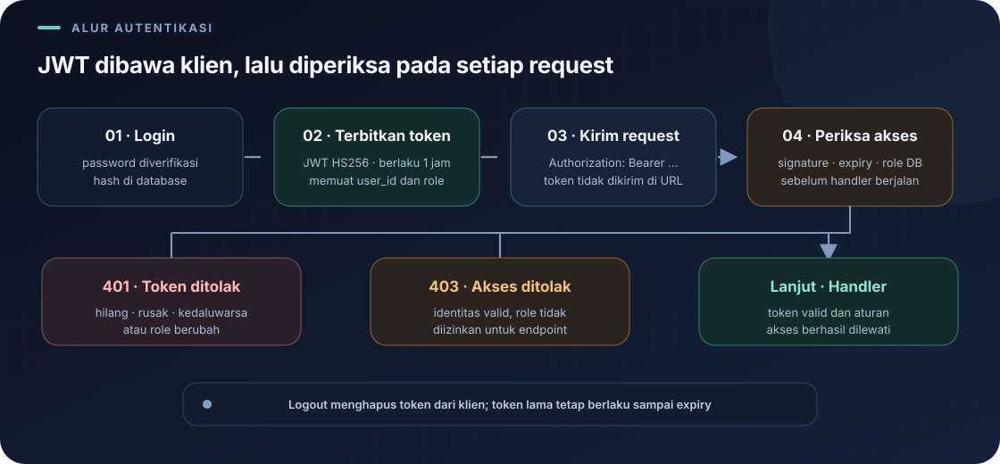

# `src/auth_middleware.rs`

File ini berisi middleware yang membatasi akses ke endpoint tertentu. Middleware adalah lapisan kecil yang dijalankan sebelum handler utama. Dalam proyek ini, middleware memvalidasi bearer JWT dan menaruh `user_id` serta role terverifikasi pada request extensions.

Navigasi: [indeks](README.md) · [routing](routes.md) · [handler autentikasi](handlers/auth.md).

> **Inti bab:** middleware memvalidasi bearer JWT, mencocokkan role token dengan database, lalu menegakkan izin role pada route.

File sumber: [auth_middleware.rs](../src/auth_middleware.rs).

## Mengapa Middleware Dibutuhkan?

Tanpa pemeriksaan ini, setiap handler menu atau pesanan harus mengulang kode pengecekan login. Middleware mengumpulkan pemeriksaan tersebut di satu tempat. `routes.rs` memasang middleware hanya pada scope yang perlu dilindungi.

Middleware ini tidak memeriksa username atau password lagi. Tugas itu dilakukan saat login. Middleware memvalidasi JWT, memastikan role token masih sama dengan role database, lalu menyediakan `user_id` dan role lewat request extensions.

## Import

- `HttpMessage` menyediakan akses ke header dan extensions request.
- `ServiceRequest` adalah request Actix yang masih berada di pipeline middleware.
- `ServiceResponse` adalah response setelah request diteruskan.
- `MessageBody` adalah trait untuk tipe body HTTP.
- `Next` mewakili middleware atau handler berikutnya dalam rantai.
- `ErrorUnauthorized` membuat error HTTP 401; token tidak valid/kedaluwarsa atau role yang sudah berubah ditolak.
- `ErrorForbidden` membuat error HTTP 403 saat identitas valid tetapi role tidak mempunyai izin.

## Fungsi `require_login`

```rust
pub async fn require_login(
    request: ServiceRequest,
    next: Next<impl MessageBody>,
) -> Result<ServiceResponse<impl MessageBody>, Error>
```

Fungsi asynchronous menerima request dan objek `next`. Hasilnya `Ok(response)` jika token lolos validasi, atau `Err(error)` jika autentikasi gagal.

Client mengirim bearer token pada header berikut:

```rust
Authorization: Bearer <access_token>
```

Middleware mengambil token dari header Authorization, memvalidasinya menggunakan algoritma HS256 yang eksplisit, memeriksa expiry, lalu mem-parsing subject menjadi ID positif. Role JWT dibandingkan dengan nilai terkini di database pada setiap request. Klaim yang tidak sah atau kedaluwarsa tidak diteruskan ke handler.

`authenticate` mengambil nilai sesudah `Bearer `, memeriksa signature dan masa berlaku JWT, lalu membaca role terbaru dari database. Jika header/token tidak ada atau tidak valid, middleware mengembalikan HTTP 401. Jika konfigurasi state autentikasi tidak tersedia, itu kesalahan server (500), bukan kesalahan kredensial klien.

Inti pengambilan token di kode:

```rust
let token = request
    .headers()
    .get(actix_web::http::header::AUTHORIZATION)
    .and_then(|value| value.to_str().ok())
    .and_then(|value| value.strip_prefix("Bearer "))
    .filter(|value| !value.is_empty())
    .ok_or_else(|| ErrorUnauthorized("Bearer token diperlukan"))?;
```

Urutannya: ambil header `Authorization`, ubah nilainya menjadi teks, buang awalan `Bearer `, tolak token kosong, lalu kembalikan `401` jika salah satu langkah tidak menghasilkan token. `?` meneruskan error itu dan menghentikan fungsi saat itu juga.

Jika token valid, `authenticate` memasukkan `AuthenticatedUser` ke request extensions. Fungsi `authorize` memeriksa role melalui aturan yang diberikan; jika role tidak boleh masuk, hasilnya `403`. Jika pemeriksaan lolos, `next.call(request).await` meneruskan request ke handler berikutnya.

## Tempat Middleware Dipasang

Pada `routes.rs`, middleware khusus dipasang per scope. Ringkasan kebijakannya:

| Middleware | Aturan akses |
|---|---|
| `require_login` | Memastikan token valid; tidak memilih role tertentu. |
| `require_admin` | Hanya admin. Dipakai untuk daftar/konfirmasi pembayaran dan perubahan role akun. |
| `require_menu_access` | Semua role boleh membaca; admin dan kasir boleh mengubah menu/stok. |
| `require_order_access` | Admin boleh semua operasi. Pembeli boleh membuat pesanan dan meminta daftar/detail miliknya; kasir ditolak. |
| `require_payment_access` | Admin boleh semua operasi di scope pembayaran. Pembeli boleh meminta pembayaran dan melihat struk miliknya; kasir ditolak. |

Handler juga menyaring kepemilikan berdasarkan ID pengguna. Jadi role `pembeli` saja tidak membuatnya bisa membaca pesanan milik orang lain.

## Batas Perlindungan Saat Ini

- Middleware memeriksa role, tetapi akses masih role-based dan belum mendukung permission khusus per pengguna.
- JWT stateless tidak dapat dicabut oleh endpoint logout; klien perlu menghapus token dan menunggu expiry untuk invalidasi server-side.
- Route yang tidak diberi middleware tetap dapat diakses tanpa login.
- Gunakan HTTPS agar bearer token tidak dapat dibaca saat transit melalui jaringan.

## Alur yang Perlu Diingat



```text
Client mengirim Authorization: Bearer <token>
    ↓
middleware memvalidasi signature, expiry, dan role database
    ↓
role memeriksa izin endpoint → user_id/role ditaruh pada request extensions
   ┌────┴────┐
 token      token valid, role?
 invalid       ┌───┴───┐
   ↓         ditolak  diizinkan
  401           ↓        ↓
              403     handler
```

---

Kembali ke [indeks catatan](README.md) atau lanjut ke [handler autentikasi](handlers/auth.md).
