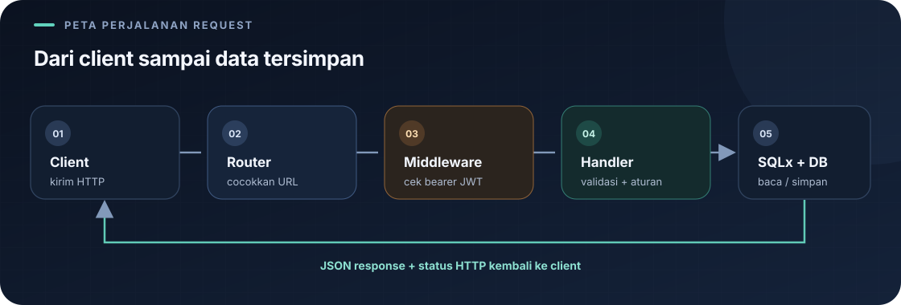

# Bagian Autentikasi

Autentikasi menjawab dua pertanyaan: **siapa yang sedang memakai API?** dan **apa yang boleh ia lakukan?** Kode membagi pekerjaan ini ke beberapa file supaya tiap bagian punya tugas yang jelas.



## Peta file

| File | Tugas dengan bahasa sederhana | Baca |
|---|---|---|
| `src/auth/mod.rs` | Mendaftarkan file layanan autentikasi. | [mod.rs](mod.md) |
| `src/auth/password.rs` | Menyimpan password sebagai hash dan mengeceknya saat login. | [password.rs](password.md) |
| `src/auth/role.rs` | Menyamakan teks role dari database dengan tipe yang dikenal program. | [role.rs](role.md) |
| `src/auth/jwt.rs` | Membuat token setelah login dan memeriksa token pada request berikutnya. | [jwt.rs](jwt.md) |
| `src/auth_middleware.rs` | Meminta token, memeriksa akun/role, dan membatasi endpoint. | [Middleware](../auth-middleware.md) |
| `src/handlers/auth.rs` | Menangani register, login, logout, profil, dan pengubahan role. | [Handler autentikasi](../handlers/auth.md) |

## Alur sederhananya

```text
Register: password → hash Argon2id → simpan ke database
Login: password baru → cocokkan dengan hash → buat JWT
Request berikutnya: kirim JWT → middleware memeriksa → handler berjalan
```

| Istilah | Arti sederhana |
|---|---|
| Hash | Bentuk hasil pengolahan password yang disimpan; bukan password asli dan tidak dirancang untuk dibalik. |
| JWT | Tiket digital bertanda tangan yang membawa ID dan role akun serta waktu kedaluwarsa. |
| Middleware | Pemeriksaan di pintu masuk yang berjalan sebelum fungsi endpoint. |
| Role | Kelompok akses akun: `admin`, `kasir`, atau `pembeli`. |

Role di dalam JWT juga dibandingkan dengan role terbaru di database oleh middleware. Jadi perubahan role dapat membuat token lama ditolak. JWT pada proyek ini bertanda tangan, bukan tempat menyimpan password atau informasi rahasia.

Lanjutkan ke [middleware](../auth-middleware.md) untuk melihat pemeriksaan pada request atau ke [handler login](../handlers/auth.md) untuk melihat proses register/login.

---

Kembali ke [indeks catatan](../README.md).
