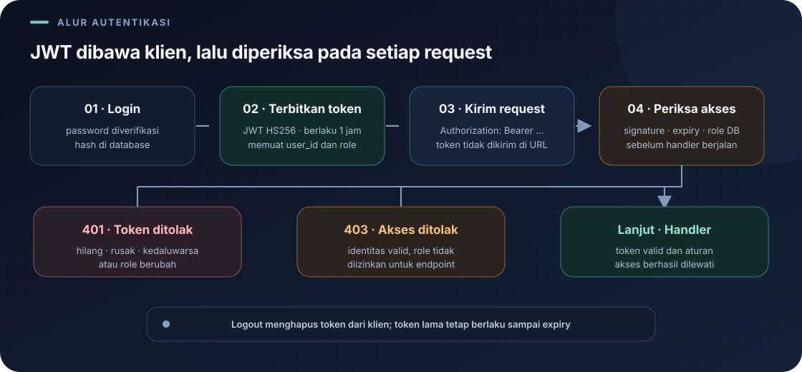

# `src/handlers/auth.rs`

File ini menangani pembuatan akun, login, logout, dan pemeriksaan akun yang sedang login. Handler menerima request HTTP, berinteraksi dengan tabel `"user"`, lalu mengirim response JSON.

Navigasi: [indeks catatan belajar](../README.md) · [peta autentikasi](../auth/README.md) · [middleware](../auth-middleware.md) · [route](../routes.md).

> **Inti bab:** login menerbitkan JWT HS256 berisi role akun; registrasi publik selalu mendapat role `pembeli`.

File sumber: [auth.rs](../../src/handlers/auth.rs).

## Konsep Singkat

- **Register** membuat akun baru dengan role `pembeli` dan menyimpan hash Argon2id, bukan password asli.
- **Login** memverifikasi password, meng-upgrade akun plaintext lama jika ada, lalu menerbitkan access token JWT.
- **Bearer token** dikirim pada header `Authorization: Bearer <token>` untuk request terlindungi.
- **Logout** memberi tahu klien untuk membuang token. JWT stateless tetap berlaku sampai kedaluwarsa.

### Siklus token



```text
POST /login → server memeriksa password → server menerbitkan JWT
  → klien mengirim Authorization: Bearer <token> → middleware memvalidasi signature dan exp
  → POST /logout → klien membuang token; token server-side tidak dicabut
```

Response login memuat `access_token`, `token_type`, dan `expires_in`. Klien harus menyimpan token secara aman dan memasukkannya ke header Authorization.

## Import dan `Credentials`

`web::Json` membaca body JSON, `HttpResponse` membuat response, dan `error` mengubah kegagalan internal menjadi error Actix. `Deserialize` membuat JSON dapat diubah menjadi struct. Layanan hash dan JWT dipisah ke `src/auth/password.rs` serta `src/auth/jwt.rs`.

```rust
#[derive(Deserialize)]
pub struct Credentials {
    pub username: String,
    pub password: String,
}
```

`Credentials` adalah bentuk body yang dipakai register dan login. Karena tidak derive `Serialize`, struct ini tidak dimaksudkan untuk dikirim balik sebagai JSON. Password disimpan sebagai hash Argon2id di kolom database `password`.

Contoh body:

```json
{
  "username": "yofan",
  "password": "password-yang-kuat"
}
```

## `register`

Endpoint: `POST /api/auth/register`. Endpoint ini terbuka dan tidak memerlukan token.

1. `body.username.trim()` menghapus spasi di awal dan akhir username untuk pemeriksaan serta penyimpanan.
2. Username kosong atau password dengan panjang kurang dari 8 byte menghasilkan `400 Bad Request`. Pemeriksaan `String::len()` di Rust menghitung byte UTF-8, bukan jumlah karakter yang terlihat. Karena itu, delapan huruf ASCII tepat memenuhi batas, sedangkan karakter Unicode tertentu dapat memakai lebih dari satu byte.
3. Password di-hash memakai Argon2id dalam `web::block` agar komputasi tidak menahan worker async.
4. Query `INSERT` menulis username dan hash password ke tabel PostgreSQL `"user"`. Tanda kutip ganda penting karena `user` adalah kata khusus PostgreSQL.
5. Role akun selalu `pembeli`; handler tidak membaca role dari body. Jika berhasil, response `201 Created`. Jika username sudah dipakai, constraint `UNIQUE` PostgreSQL dikenali dan handler mengembalikan `409 Conflict`. Error lain menjadi `500`.

Password asli tidak disimpan atau dikirim kembali. Password dibatasi maksimal 128 byte untuk membatasi input yang diproses.

## `login`

Endpoint: `POST /api/auth/login`. Endpoint terbuka karena pengguna belum mempunyai token.

1. Query mencari `id` dan hash password berdasarkan username.
2. Username yang tidak ditemukan dan password yang salah menghasilkan pesan `401` yang sama.
3. Hash Argon2id diverifikasi. Jika nilai database adalah plaintext lama, login yang berhasil menggantinya dengan hash baru.
4. Server membuat JWT HS256 dengan `user_id` sebagai subject dan masa berlaku satu jam.
5. Response berisi `access_token`, `token_type: Bearer`, `expires_in`, dan role akun; secret penandatangan tidak pernah dikirim ke klien.

## `logout`

Endpoint: `POST /api/auth/logout`. Karena JWT tidak menyimpan session di server, handler tidak dapat membatalkan token yang sudah diterbitkan. Klien harus menghapus access token; token lama tetap valid sampai satu jam.

Di `routes.rs`, logout tidak ditempatkan di scope yang memerlukan login. Ia dapat dipanggil untuk membersihkan token lokal meskipun klien tidak sedang login.

## `me`

Endpoint: `GET /api/auth/me`. Route ini dilindungi middleware login dan membaca user ID serta role terverifikasi dari request extensions.

1. Middleware sudah memvalidasi signature, expiry, dan kecocokan role DB, lalu menyimpan `AuthenticatedUser` pada request extensions.
2. Handler membaca `user_id` dan role dari extension tersebut dan mengambil username dari tabel `"user"`.
3. Jika akun masih ada, response `200` berisi `id`, `username`, dan `role`; jika akun sudah tidak ada, response `401` diberikan.

## Mengubah Role

`PUT /api/auth/users/{id}/role` dilindungi khusus admin. Body menerima hanya `admin`, `kasir`, atau `pembeli`; role dari request lain menghasilkan `400`. Register tidak menerima role untuk mencegah pengguna membuat akun admin sendiri. Middleware mencocokkan role JWT dengan database pada setiap request, jadi token lama segera ditolak setelah role akun berubah dan pengguna perlu login ulang.

## Membaca Tipe dan Hasil

Contoh signature register:

```rust
pub async fn register(
    state: web::Data<AppState>,
    body: web::Json<Credentials>,
) -> Result<HttpResponse, actix_web::Error>
```

- `web::Data<AppState>` memberi handler akses ke pool database.
- `web::Json<Credentials>` meminta Actix membaca JSON dan mengubahnya menjadi `Credentials`.
- `Result<HttpResponse, actix_web::Error>` berarti fungsi dapat menghasilkan response normal (`Ok`) atau error framework (`Err`).
- `?` setelah operasi SQL atau hashing mengembalikan error lebih awal bila operasi gagal.
- `HttpResponse::Created().json(...)` memilih status 201 dan mengubah data menjadi JSON.

## Mengapa Query Menulis `"user"`?

Di PostgreSQL, `user` memiliki arti khusus. Bila nama tabel benar-benar `user`, tulis sebagai identifier yang dikutip: `"user"`. Dalam Rust, contoh query ditulis seperti ini:

```rust
r#"SELECT id, password FROM "user" WHERE username = $1"#
```

Raw string Rust dimulai `r#"` dan berakhir `"#`; tanda kutip di dalamnya menjadi teks biasa. Nama tabel dan nama kolom harus sama dengan skema di `db.rs`: `"user"`, `id`, `username`, dan `password`.

## Kesalahan yang Umum

- **`syntax error at or near "user"`**: tabel ditulis `user` tanpa tanda kutip ganda di SQL.
- **`column "password" does not exist`**: pastikan startup terbaru sudah menambahkan kolom `password`.
- **Endpoint memberi 403**: token valid, tetapi role tidak memiliki hak ke operasi tersebut. `401` berarti token tidak valid, kedaluwarsa, atau role akun berubah.
- **Startup menolak konfigurasi**: `JWT_SECRET` wajib minimal 32 byte; buat secret acak dan jangan memakai contoh literal.

## Catatan Keamanan

JWT bearer adalah kredensial: jangan mencatat atau membagikannya. Gunakan HTTPS di luar komputer lokal. Logout hanya menghapus token dari sisi klien, bukan mencabutnya dari server; endpoint register juga terbuka bagi siapa pun yang dapat mengakses server. Batas 8 byte adalah validasi minimum, bukan pengukuran kualitas password.
