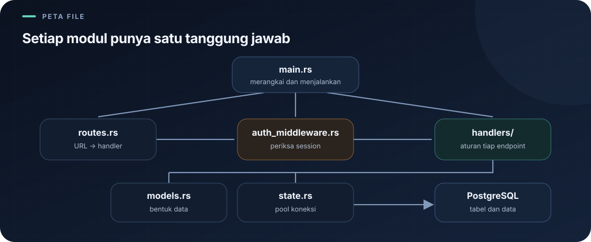

# `src/handlers/mod.rs`

Navigasi: [indeks](../README.md) · [autentikasi](auth.md) · [menu](menus.md) · [pesanan](orders.md) · [pembayaran](payments.md).

> **Inti bab:** deklarasi `pub mod` menghubungkan nama modul handler dengan file `.rs` yang berisi implementasinya.

File sumber: [mod.rs](../../src/handlers/mod.rs).

File ini mendaftarkan modul handler yang tersedia. Isinya deklarasi modul, bukan implementasi endpoint:



```rust
pub mod menus;
pub mod orders;
pub mod format;
pub mod auth;
pub mod payments;
```

Setiap deklarasi `pub mod nama;` memberi tahu compiler bahwa implementasi modul berada di file `nama.rs` pada folder yang sama, dan membuat modul itu dapat diakses dari luar `handlers`. `format.rs` berisi fungsi format harga yang dipakai handler lain; `auth.rs` berisi endpoint autentikasi; `payments.rs` berisi endpoint pembayaran dan struk.

File ini tidak memuat logika endpoint. Ia mengatur struktur modul. Baca [handler autentikasi](auth.md), [format harga](format.md), [handler menu](menus.md), [handler pesanan](orders.md), dan [handler pembayaran](payments.md) untuk implementasinya.

---

Kembali ke [indeks catatan](../README.md).
