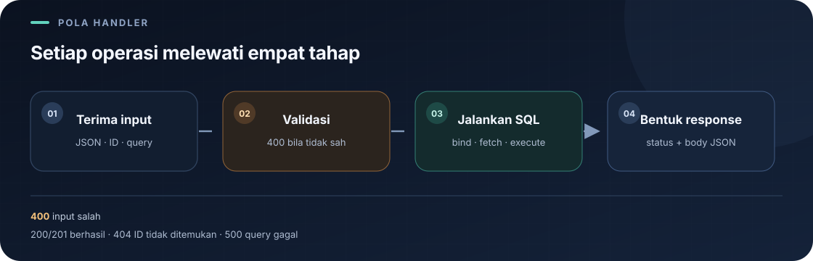
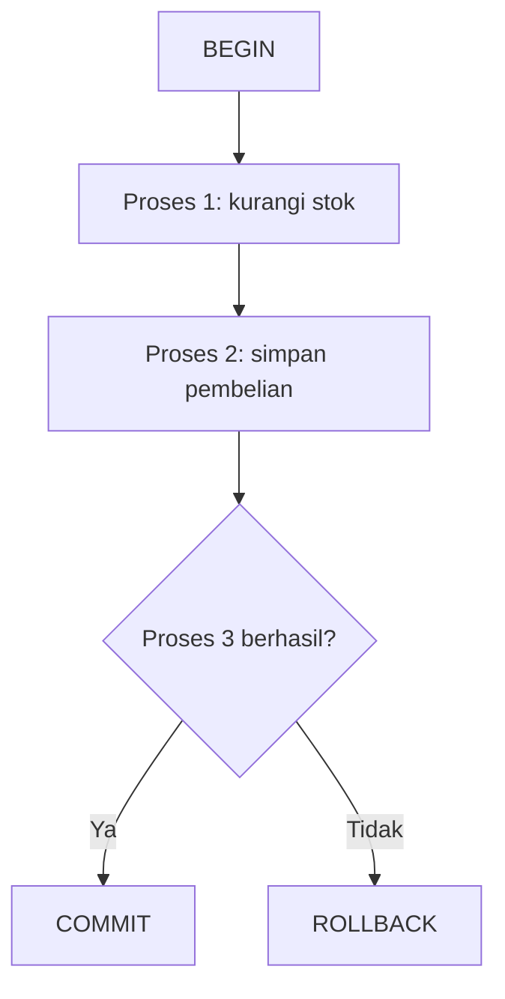
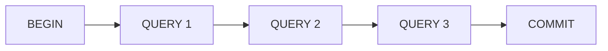
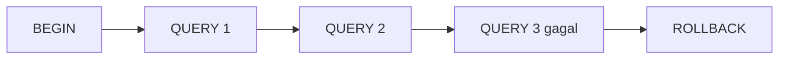

# `src/handlers/orders.rs`

File ini mengimplementasikan endpoint daftar/detail pesanan dan operasi create, replace, patch, delete beserta validasinya.

Navigasi: [indeks catatan belajar](../README.md) · [model data](../models.md) · [routing](../routes.md) · [handler autentikasi](auth.md).

> **Inti bab:** pembeli membuat order dari menu dan jumlah; stok dikurangi atomik, dan riwayat pembeli dibatasi ke order miliknya.

File sumber: [orders.rs](../../src/handlers/orders.rs).

### Isi halaman

- [Daftar dan filter pesanan](#get_orders)
- [Baca satu pesanan](#get_order)
- [Buat pesanan](#create_order)
- [Memulai dan mengelola transaksi SQLx](#memulai-dan-mengelola-transaksi-sqlx)
- [Ganti semua field](#update_order)
- [Ubah sebagian field](#patch_order)
- [Hapus pesanan](#delete_order)
- [Validasi input](#validate_order)
- [Cara kerja query dan fetch](#perbedaan-query_as-dan-query_scalar)
- [Contoh request](#contoh-request-pesanan)

### Peta operasi



| Operasi | Input | Hasil sukses | Hal yang perlu diingat |
|---|---|---|---|
| GET daftar | Query opsional `field` | Array | Urut ID turun; filter mengambil satu kolom. |
| GET satu | ID pada path | Array | ID tidak ada → `404`. |
| POST | Nama, menu, jumlah, metode pembayaran | Object, `201` | Order dan payment lunas dicatat atomik. |
| PUT | ID + `OrderInput` lengkap | Object, `200` | Mengganti semua field. |
| PATCH | ID + satu atau lebih field | Object, `200` | Field lain tetap; body `{}` ditolak. |
| DELETE | ID | Pesan, `200` | ID yang tidak ada → `404`. |

**Urutan membaca handler:** kenali extractor request → ikuti validasi → cocokkan placeholder SQL dengan `.bind()` → lihat hasil `fetch_*` → baca status response.

## Import

Actix `web`, `HttpResponse`, `Responder` menangani request dan response. `HashMap<String, String>` membaca query parameter. `Order`, `OrderInput`, dan `OrderPatchInput` adalah model data. `AppState` memberi akses ke pool DB.

## `get_orders`

Menangani `GET /api/orders`. Tanpa parameter `field`, mengambil semua kolom dan mengurutkan `id DESC`, lalu mengubah tiap row menjadi array `[id, customer_name, item_name, quantity, status]`. Dengan field:

`admin` melihat semua pesanan. `pembeli` melihat daftar dan detail miliknya saja; query menyaring dengan `user_id`. `kasir` ditolak sebelum handler berjalan. Lihat [handler autentikasi](auth.md) untuk role dan bearer JWT.

- `id`: array ID integer.
- `customer_name`: array nama pelanggan.
- `item_name`: array nama item.
- `quantity`: array jumlah integer.
- `status`: array status.
- Nilai lain: `400` beserta daftar field valid.

Daftar penuh memakai `query_as::<_, Order>`; filter satu kolom memakai `query_scalar` dengan tipe yang sesuai. Hasil field tunggal tetap dikemas sebagai JSON array. Error query ditangani helper error.

Contoh daftar penuh:

```json
[
  [12, "Ayu", "Nasi Goreng", 2, "menunggu"],
  [11, "Budi", "Es Teh", 1, "diproses"]
]
```

Setiap nilai pada row array mengikuti urutan kolom yang sudah disebutkan. Konsumen API perlu membaca posisi tersebut; response ini belum memakai nama field JSON.

## `get_order`

Menangani `GET /api/orders/{id}`. Mengikat ID ke `$1` dan mencari dengan `fetch_optional`. Ditemukan: `200` dan array `[id, customer_name, item_name, quantity, status]`; tidak ditemukan: `404`; gagal query: `500`.

## `create_order`

Menangani `POST /api/orders`. Input memakai `customer_name`, `menu_id`, `quantity`, dan `payment_method`; klien tidak menentukan harga atau status. Metode hanya `cash` atau `bank_transfer`. Dalam satu transaksi, handler mengurangi stok bila cukup, mengambil harga/nama menu dari database, menyimpan order berstatus `lunas` beserta snapshot harga, dan membuat payment lunas dengan `paid_at`. Total dihitung dari harga snapshot dikali jumlah. Jika stok kurang atau salah satu query gagal, seluruh transaksi dibatalkan. Response berisi data order dan object `payment` dengan ID, metode, status, total, dan mata uang.

## Memulai dan Mengelola Transaksi SQLx

### Membaca `begin()` dan `match`

Berikut pola yang digunakan handler untuk memulai transaksi:

```rust
let mut transaction = match state.db.begin().await {
	Ok(transaction) => transaction,
	Err(error) => return database_error("Gagal memulai pembelian", error),
};
```

Arti bagian-bagian pentingnya:

| Bagian | Arti |
|---|---|
| `let` | Mendeklarasikan binding, yaitu nama lokal untuk menyimpan nilai. |
| `mut` | Mengizinkan nilai melalui binding ini dipinjam secara mutable atau diubah jika tipenya mendukungnya. |
| `transaction` | Nama variabel yang menyimpan objek transaksi SQLx setelah transaksi berhasil dimulai. |
| `state.db` | Pool database yang disimpan di `AppState`; pada handler ini pool tersebut dipakai sebagai sumber koneksi. |
| `.begin()` | Meminta SQLx memulai transaksi pada koneksi database. Untuk pool, proses ini juga memperoleh koneksi yang akan dipakai transaksi. |
| `.await` | Menunggu operasi asynchronous selesai tanpa memblokir thread secara sinkron. Hasilnya baru tersedia sesudah future selesai. |
| `match` | Memeriksa nilai enum dan menjalankan cabang sesuai variannya. |
| `Ok(transaction)` | Operasi berhasil. Nilai transaksi di dalam `Ok` dipindahkan ke binding `transaction` di luar. |
| `Err(error)` | Operasi gagal. Nilai error diikat ke nama `error` untuk diteruskan ke penanganan error. |
| `return` | Mengakhiri fungsi handler saat itu juga dan mengirim response error; query pembelian selanjutnya tidak dijalankan. |

Pemanggilan `begin().await` menghasilkan `Result` karena operasi database dapat sukses atau gagal. Secara konseptual, tipenya adalah `Result<Transaction, sqlx::Error>`; tipe transaksi lengkapnya bergantung pada database dan pool yang dipakai. `Result` memiliki dua kemungkinan: `Ok(nilai)` atau `Err(error)`. `match` memastikan keduanya ditangani. Jika koneksi tidak bisa diperoleh atau transaksi tidak berhasil dimulai, cabang `Err` mengirim response server dan tidak ada operasi pembelian yang diteruskan.

### Mengapa `transaction` Mutable?

`mut` pada binding Rust mengizinkan peminjaman mutable melalui binding tersebut. Ini bukan instruksi untuk langsung mengubah data database. Perubahan data baru diminta ketika query seperti `UPDATE` atau `INSERT` dijalankan; keberhasilan query di dalam transaksi pun belum membuatnya permanen sebelum `commit`.

Contoh sederhana perbedaan binding immutable dan mutable:

```rust
let jumlah = 1;
// jumlah = 2; // Tidak bisa: binding tidak mutable.

let mut stok = 5;
stok -= 1; // Bisa: binding stok mutable.
```

Pada transaksi, yang penting adalah peminjaman mutable. Query SQLx untuk PostgreSQL menerima koneksi yang dapat dipakai secara mutable. Bentuk `&mut *transaction` berarti: dereferensikan objek transaksi hingga koneksi dasarnya, lalu pinjam koneksi itu sebagai `&mut`. Operasi query menggunakan peminjaman tersebut, sehingga binding transaksi perlu dideklarasikan `mut`.

```rust
let mut transaction = state.db.begin().await?;

sqlx::query("UPDATE menu SET stok = stok - 1 WHERE id = $1")
	.bind(1_i32)
	.execute(&mut *transaction)
	.await?;
```

`&mut` adalah referensi mutable eksklusif: selama peminjaman berlangsung, bagian lain kode tidak dapat memakai koneksi yang sama secara bersamaan melalui referensi lain yang bertentangan. Setiap query selesai menunggu sebelum peminjaman berikutnya dipakai. `mut transaction` menyiapkan binding untuk peminjaman tersebut; ia tidak dengan sendirinya mengirim query, memulai transaksi baru, ataupun meng-commit data.

### Apa yang Terjadi Saat `begin().await`?

Urutan berikut menjelaskan perilaku yang dapat diandalkan tanpa mengasumsikan detail protokol internal SQLx:

1. Aplikasi memanggil `begin()` pada pool database melalui `state.db`.
2. Jika `state.db` adalah `PgPool`, SQLx memperoleh satu koneksi dari pool. Koneksi yang sedang dipakai aplikasi lain tidak dipakai bersamaan untuk transaksi ini.
3. Koneksi tersebut dipinjam untuk menjalankan transaksi. Pool tidak boleh menggunakannya sebagai koneksi bebas untuk operasi lain sampai transaksi selesai dan koneksi dikembalikan.
4. SQLx melalui driver PostgreSQL meminta database memulai transaksi pada koneksi tersebut. Efeknya setara dengan perintah SQL `BEGIN`; detail komunikasi/protokol yang persis merupakan urusan implementasi SQLx dan driver.
5. PostgreSQL menandai transaction context pada koneksi itu. Query berikutnya pada koneksi yang sama menjadi bagian transaksi tersebut.
6. Jika berhasil, SQLx mengembalikan objek `Transaction` yang mewakili transaksi dan mengelola koneksinya.
7. Jika memperoleh koneksi atau memulai transaksi gagal, pemanggilan menghasilkan `Err`. Handler dapat mencatat error dan mengirim response tanpa menjalankan query pembelian.

Di PostgreSQL, `BEGIN` memulai blok transaksi eksplisit pada koneksi. Pada titik ini belum ada stok yang dikurangi atau baris pembelian yang ditambahkan karena belum ada query perubahan data yang dijalankan. Transaksi memiliki konteks untuk mengelompokkan query berikutnya; detail seperti snapshot pembacaan mengikuti isolation level dan query yang berjalan.

Koneksi harus sama untuk seluruh query karena status transaksi melekat pada koneksi tersebut. Jika query pertama dijalankan pada satu koneksi dan query berikutnya melalui pool secara terpisah, query kedua bisa mendapatkan koneksi lain dan berada di luar transaksi pertama. Itulah sebabnya query dalam contoh menggunakan `&mut *transaction`, bukan `&state.db`.

SQLx memastikan pemanggilan `begin()` menghasilkan objek transaksi atau error. Uraian bahwa pool memperoleh koneksi lalu driver memulai transaksi menjelaskan perilaku yang terlihat dari API. Ini bukan klaim tentang urutan pesan internal, optimasi driver, atau mekanisme wire protocol tertentu.

### Contoh Pembelian: Tiga Operasi dalam Satu Transaksi

Misalkan kondisi awal database adalah stok menu 1 sebanyak 5, belum ada pembelian baru, dan belum ada detail pembelian baru. Sistem menjalankan:

```sql
UPDATE menu
SET stok = stok - 1
WHERE id = 1;

INSERT INTO pembelian (user_id, total)
VALUES (10, 15000);

INSERT INTO detail_pembelian (pembelian_id, menu_id, jumlah)
VALUES (1, 1, 1);
```

Tabel berikut menunjukkan perubahan dari sudut pandang transaksi. Kolom “data committed” menegaskan bahwa perubahan di tengah transaksi belum permanen; pembaca lain umumnya tetap melihat keadaan committed sebelumnya.

| Tahap | Stok menu 1 yang terlihat di transaksi | Baris pembelian baru | Baris detail baru | Status perubahan |
|---|---:|---|---|---|
| Sebelum transaksi | 5 | Belum ada | Belum ada | Data awal sudah committed. |
| `BEGIN`, lalu proses 1 berhasil | 4 | Belum ada | Belum ada | Pengurangan stok belum committed. |
| Proses 2 berhasil | 4 | Ada: user 10, total 15000 | Belum ada | Kedua query sukses, tetapi belum committed. |
| Proses 3 gagal | 4 | Ada di dalam transaksi | Tidak berhasil ditambahkan | Perubahan proses 1 dan 2 masih dapat di-rollback. |
| Setelah `ROLLBACK` | 5 | Belum ada | Belum ada | Semua perubahan transaksi dibatalkan; kembali ke keadaan awal. |

Query yang sukses berarti database berhasil menjalankan query di dalam transaksi. Itu berbeda dari `COMMIT`: sebelum commit, perubahan masih bagian dari transaksi yang dapat dibatalkan. Jika proses 3 gagal, aplikasi mendeteksi `Err`, lalu menjalankan rollback. PostgreSQL membatalkan perubahan proses 1 dan 2 yang belum committed sehingga stok dan data pembelian kembali ke keadaan sebelum transaksi.



### `COMMIT` dan `ROLLBACK`

```rust
transaction.commit().await?;
```

`commit()` meminta database mengakhiri transaksi dengan menyimpan seluruh perubahan yang dilakukan dalam transaksi itu sebagai perubahan committed. Jika semua operasi bisnis berhasil, commit adalah langkah yang membuat hasil pembelian permanen. Method ini asynchronous, sehingga `.await` menunggu hasilnya; `?` meneruskan error kepada pemanggil jika fungsi memiliki return type `Result`.

```rust
transaction.rollback().await?;
```

`rollback()` meminta database membatalkan seluruh perubahan yang belum committed di transaksi tersebut. Gunakan saat validasi lanjutan atau query gagal sehingga operasi yang sudah sempat berhasil tidak tertinggal sebagian. Setelah commit atau rollback, transaksi berakhir dan koneksi dapat dikembalikan untuk penggunaan pool.

| Perintah | Dipakai ketika | Pengaruh pada query sebelumnya |
|---|---|---|
| `COMMIT` | Semua langkah transaksi berhasil dan konsisten. | Semua perubahan transaksi menjadi committed. |
| `ROLLBACK` | Ada langkah gagal atau keputusan untuk membatalkan operasi. | Semua perubahan transaksi yang belum committed dibatalkan. |





### Implementasi SQLx

Contoh berikut menganggap pool bertipe `PgPool` dan menggunakan ID contoh dari ilustrasi. Fungsi mengembalikan error SQLx; handler Actix dapat menerjemahkan error itu menjadi response dengan `database_error`.

```rust
use sqlx::PgPool;

async fn proses_pembelian(pool: &PgPool) -> Result<(), sqlx::Error> {
	let mut transaction = match pool.begin().await {
		Ok(transaction) => transaction,
		Err(error) => return Err(error),
	};

	let hasil_query = async {
		sqlx::query("UPDATE menu SET stok = stok - 1 WHERE id = $1")
			.bind(1_i32)
			.execute(&mut *transaction)
			.await?;

		sqlx::query("INSERT INTO pembelian (user_id, total) VALUES ($1, $2)")
			.bind(10_i32)
			.bind(15_000_i32)
			.execute(&mut *transaction)
			.await?;

		sqlx::query(
			"INSERT INTO detail_pembelian (pembelian_id, menu_id, jumlah) VALUES ($1, $2, $3)",
		)
		.bind(1_i32)
		.bind(1_i32)
		.bind(1_i32)
		.execute(&mut *transaction)
		.await?;

		Ok::<(), sqlx::Error>(())
	}
	.await;

	match hasil_query {
		Ok(()) => transaction.commit().await,
		Err(error) => {
			if let Err(rollback_error) = transaction.rollback().await {
				eprintln!("Gagal melakukan rollback: {rollback_error}");
			}
			Err(error)
		}
	}
}
```

Setiap `execute(&mut *transaction)` menjalankan query melalui koneksi yang dipinjam untuk transaksi yang sama. `&mut *transaction` memperoleh referensi mutable ke koneksi di dalam objek transaksi; tanpa itu, query tidak secara eksplisit menggunakan koneksi transaksi tersebut. Memanggil query langsung dengan `&pool` dapat mengambil koneksi lain, sehingga query tidak lagi dijamin menjadi bagian transaksi ini.

Blok `async` mengumpulkan tiga hasil query menjadi satu hasil operasi: error query pertama yang gagal menghentikan blok melalui `?`. Sesudah blok selesai, `match` menjalankan commit jika semuanya sukses atau rollback jika ada error. Jika rollback juga gagal, contoh mencatat error rollback tetapi tetap mengembalikan error query awal sebagai penyebab utama kegagalan operasi. Pada aplikasi nyata, ID pembelian biasanya diperoleh dari hasil `INSERT ... RETURNING id` lalu dipakai untuk detail; query pengurangan stok juga perlu memastikan stok cukup dan memeriksa jumlah row yang berubah. Hal-hal itu adalah validasi bisnis tambahan, bukan bagian dari penjelasan dasar transaksi.

### Jika Transaksi Ditinggalkan dan Hubungannya dengan ACID

Jika objek `Transaction` SQLx dijatuhkan tanpa `commit()` atau `rollback()`, transaksi tidak dianggap berhasil dan perubahan tidak boleh diasumsikan committed. Implementasi `Drop` pada transaksi memberi tahu transaction manager koneksi bahwa transaksi perlu di-rollback; ini adalah cleanup otomatis agar transaksi yang ditinggalkan tidak diperlakukan sebagai transaksi sukses. Karena `Drop` berjalan sinkron, kode pemanggil tidak dapat melakukan `.await` pada cleanup itu atau menerima hasil rollback-nya. Karena itu, aplikasi sebaiknya memanggil `rollback().await` secara eksplisit saat mengetahui operasi gagal agar penyelesaian dan kemungkinan error rollback dapat ditangani dengan jelas. Jangan mengandalkan `Drop` sebagai pengganti alur error yang eksplisit.

Transaksi mengelompokkan beberapa query agar sistem tidak menyimpan keadaan setengah jadi. Ini terutama terkait prinsip **Atomicity** pada ACID: kumpulan perubahan diperlakukan sebagai satu unit, yaitu semuanya committed atau perubahan yang belum committed dibatalkan. Konsistensi data juga terbantu karena aturan bisnis dapat dijaga melintasi beberapa tabel, tetapi transaksi sendiri tidak otomatis menjamin setiap aturan benar; query, constraint, dan validasi tetap harus tepat.

Transaksi jangan dibiarkan terbuka terlalu lama. Selama koneksi dipinjam, kapasitas pool berkurang; query yang menulis dapat menahan lock; dan transaksi panjang dapat mengganggu pekerjaan lain serta mempertahankan keadaan database lebih lama dari perlu. Lakukan validasi yang tidak membutuhkan transaksi sebelum `begin()`, jalankan query yang dibutuhkan, lalu segera commit atau rollback.

## `update_order`

Menangani `PUT /api/orders/{id}` dan mengganti seluruh field yang dapat diedit. Route admin-only. Input lengkap divalidasi; query menetapkan nama pelanggan, item, jumlah, status pada ID yang diberikan. Row ditemukan menghasilkan `200` dan objek; ID tidak ditemukan `404`; error SQL `500`.

## `patch_order`

Menangani `PATCH /api/orders/{id}` dengan field opsional. Route admin-only.

1. Menolak jika semua field `customer_name`, `item_name`, `quantity`, `status` bernilai `None`.
2. Teks yang dikirim tidak boleh kosong setelah trim.
3. Quantity yang dikirim harus lebih besar dari nol.
4. Query memakai `COALESCE` agar field yang tidak dikirim mempertahankan nilai lama.
5. String opsional di-trim melalui `as_deref().map(str::trim)` dan semua nilai dibind sebagai parameter SQL.
6. Hasil: `200` jika row ditemukan, `404` jika ID tidak ada, `500` jika query gagal.

## `delete_order`

Menangani `DELETE /api/orders/{id}`. Route admin-only. Menghapus row dan memeriksa `rows_affected()`: lebih dari nol mengembalikan `200` dan pesan berhasil; nol mengembalikan `404`; error database `500`.

## `validate_order`

Helper privat untuk create dan PUT. Nama pelanggan, nama item, dan status harus tidak kosong setelah trim. `quantity` harus lebih besar dari nol. Pelanggaran mengembalikan response `400`; input valid mengembalikan `None`.

## `database_error`

Mencetak pesan konteks dan detail SQLx ke log server melalui `eprintln!`. Response ke klien berstatus `500` dan hanya berisi pesan konteks dalam JSON.

## Bentuk dan Urutan Hasil

Daftar pesanan terurut ID menurun. GET daftar/detail menghasilkan array dengan urutan kolom yang disebutkan; create/update/patch menghasilkan objek `Order` hasil serialisasi.

<details>
<summary>🔎 Pendalaman: tipe handler, Rust, SQLx, dan SQL</summary>

Bagian ini menguraikan sintaks yang dipakai implementasi. Mulai dari contoh request di bawah jika tujuanmu saat ini hanya memakai API.

## Arti Tipe Parameter dan Return Handler

Fungsi handler umumnya berbentuk `pub async fn nama(state, path/body) -> impl Responder`.

- `pub`: route dari modul lain boleh memanggil fungsi.
- `async`: fungsi menghasilkan future dan dapat menunggu query dengan `.await`.
- `web::Data<AppState>`: state Actix yang membawa pool DB.
- `web::Path<i32>`: extractor segmen `{id}` di URL sebagai integer.
- `web::Json<OrderInput>`: extractor body JSON; Actix/Serde mencoba mengubah JSON menjadi model sebelum masuk ke fungsi.
- `web::Query<HashMap<String, String>>`: extractor parameter query menjadi map teks, misalnya `?field=status`.
- `impl Responder`: tipe return konkret disembunyikan di signature, tetapi nilainya harus memenuhi kontrak response Actix.

`state.db` mengambil field pool dari state. Referensi `&state.db` meminjam pool untuk query, bukan memindahkan pool keluar dari state.

## `get_orders`: Filter, `Result`, dan Early Return

`query.get("field")` menghasilkan `Option<&String>`. `.map(String::as_str)` menjalankan konversi hanya ketika nilai ada, jadi hasilnya `Option<&str>`. `match field` memisahkan:

- `None`: tidak ada filter, ambil semua kolom.
- `Some("id")`, `Some("customer_name")`, dan seterusnya: nilai filter cocok persis.
- `_`: wildcard untuk nilai lain, dikembalikan sebagai `400`.

Pada branch tanpa filter, `query_as::<_, Order>` meminta SQLx memetakan kolom query ke struct `Order`. `_` membiarkan compiler menyimpulkan tipe query. `.fetch_all(&state.db).await` menghasilkan `Result<Vec<Order>, sqlx::Error>`.

`match` luar memeriksa `Ok(orders)` dan `Err(error)`. Dalam cabang sukses:

- `orders.into_iter()` mengonsumsi vector dan membuat iterator row.
- `.map(|order| { ... })` memakai closure untuk mengubah setiap `Order` menjadi JSON array. Closure adalah fungsi kecil; `|order|` menyatakan satu parameter.
- Macro `serde_json::json!([ ... ])` membangun array JSON sesuai urutan elemen.
- `.collect::<Vec<_>>()` mengumpulkan iterator sebagai vector; `_` berarti tipe elemennya disimpulkan dari hasil closure.
- `return HttpResponse::Ok().json(values)` mengembalikan response dari fungsi sekarang. `return` ini diperlukan karena hasil daftar penuh disajikan langsung.
- Pada error, `return database_error(...)` juga menghentikan fungsi lebih awal.

Filter kolom tunggal menghasilkan `Result<Vec<T>, sqlx::Error>`. `.map(|values| serde_json::json!(values))` di sini adalah `Result::map`, bukan iterator `map`: ia mengubah nilai sukses `Vec<T>` menjadi JSON, sambil membiarkan `Err` tetap menjadi `Err`. Karena beberapa jenis query punya tipe nilai berbeda, setiap arm menyusun hasil ke `serde_json::Value` yang kompatibel. `match result` setelah `match field` lalu mengubah `Ok(values)` menjadi response 200 dan `Err(error)` menjadi response 500.

## Perbedaan `query_as` dan `query_scalar`

- `sqlx::query_as::<_, Order>(sql)` memilih beberapa kolom dan memetakannya menjadi `Order`. Kolom hasil harus kompatibel dengan field struct.
- `sqlx::query_scalar::<_, i32>(sql)` mengambil satu kolom, di sini ID integer. Tipe sesudah koma menentukan tipe nilai hasil; contoh lain adalah `String` untuk nama/status.
- `fetch_all` mengambil nol atau banyak hasil, karena daftar boleh kosong.
- `fetch_optional` menghasilkan `Result<Option<T>, Error>`: query sukses dengan row menjadi `Ok(Some(row))`; query sukses tanpa row menjadi `Ok(None)`; query gagal menjadi `Err(error)`.
- `fetch_one` mengambil satu row dan menghasilkan error jika tidak ada row; method ini bukan pemeriksaan bahwa seluruh query hanya menghasilkan satu row. Create memakai ini setelah INSERT RETURNING.
- `execute` menjalankan query tanpa mengambil row model, seperti DELETE.

## `get_order`, Create, dan Update

Pada `get_order` dan `update_order`, pola `match` bercabang menjadi `Ok(Some(order))`, `Ok(None)`, dan `Err(error)`. `Some(order)` mengikat row yang ditemukan ke variabel `order`; `None` berarti SQL sukses tetapi ID tidak cocok; `Err` berarti masalah database.

Pada create:

1. `if let Some(response) = validate_order(&body)` adalah pencocokan ringkas untuk nilai opsional. Jika helper menemukan kesalahan, fungsi langsung `return` dengan response itu; jika `None`, query berlanjut.
2. `INSERT ... VALUES ($1, $2, $3, $4) RETURNING ...` menulis row dengan parameter lalu meminta database mengembalikan kolom hasil.
3. `.bind(...)` mengikat nilai satu per satu ke `$1` sampai `$4` sesuai urutan query. Input teks dipanggil `.trim()` agar whitespace tepi tidak disimpan.
4. `fetch_one` mengambil row baru. `HttpResponse::Created()` membentuk status 201, dan `.json(order)` menserialisasi model menjadi body JSON.

Pada update, ID diikat sebagai parameter kelima. `fetch_optional` dipakai agar ID yang tidak ada dapat diterjemahkan menjadi 404, bukan sebagai error internal.

## `patch_order`: Kondisi, Borrow, dan Nilai Opsional

- `is_none()` memeriksa apakah sebuah `Option` tidak berisi nilai.
- Rangkaian `&&` menyatakan semua field tidak diberikan; jika satu saja `Some`, keseluruhan kondisi salah dan body tidak dianggap kosong.
- `||` menyatakan cukup ada satu field teks yang tidak valid untuk menolak request.
- `as_ref()` melihat nilai di dalam `Option<String>` sebagai referensi, sehingga pemeriksaan tidak memindahkan String dari body.
- `is_some_and(|name| name.trim().is_empty())` memanggil closure hanya jika Option berisi nilai. Closure menerima nama; `trim().is_empty()` mendeteksi teks yang hanya whitespace. Jika Option adalah `None`, hasil `is_some_and` adalah `false`.
- `body.quantity.is_some_and(|quantity| quantity <= 0)` memeriksa nilai quantity hanya saat tersedia. `i32` dapat disalin, sehingga nilai tetap dapat dipakai untuk bind.
- `as_deref()` pada `Option<String>` menghasilkan `Option<&str>` dengan meminjam teks. `.map(str::trim)` menjalankan trim hanya untuk `Some`; `None` tetap `None`.

Query menggunakan `COALESCE($1, customer_name)` dan pola serupa. SQL `COALESCE` mengambil argumen pertama yang bukan `NULL`: jika parameter baru ada, kolom diperbarui; jika parameter `NULL`, kolom mempertahankan nilai sebelumnya. Payload JSON `null` dan field yang tidak disertakan sama-sama menjadi `None` pada model saat ini, sehingga keduanya berarti “jangan ubah”.

## `delete_order`: Guard pada Pola

`execute(...).await` menghasilkan `Result` berisi metadata query. `match` memakai:

- `Ok(result) if result.rows_affected() > 0`: `if ...` setelah pola adalah match guard. Arm ini hanya dipilih untuk query sukses yang menghapus setidaknya satu row.
- `Ok(_)`: query sukses tetapi guard pertama tidak terpenuhi; `_` mengabaikan nilai hasil karena tidak diperlukan.
- `Err(error)`: query gagal.

## Validasi dan Error

`validate_order(&OrderInput) -> Option<HttpResponse>` meminjam input. `Some(response)` berarti ada masalah yang dapat langsung dikirim sebagai 400; `None` berarti valid. `trim()` menghasilkan potongan teks tanpa whitespace ujung, dan `is_empty()` mengecek apakah potongan tersebut tidak berisi karakter.

`database_error(message: &str, error: sqlx::Error)` menerima pesan konteks sebagai string slice yang dipinjam dan error SQLx yang dimiliki fungsi helper. `eprintln!` menulis detail ke standard error/log server; body response hanya memuat pesan yang aman untuk klien.

## Mengapa Query Memakai Placeholder?

`$1`, `$2`, dan seterusnya adalah parameter positional PostgreSQL. `.bind(...)` mengirim nilai secara terpisah dari teks SQL, dengan urutan yang harus sesuai placeholder. Ini lebih aman daripada menyisipkan teks input ke SQL dan mempertahankan penanganan tipe oleh SQLx.

## Response HTTP, JSON, dan Macro

`HttpResponse::Ok()`, `Created()`, `BadRequest()`, `NotFound()`, dan `InternalServerError()` memilih status HTTP 200, 201, 400, 404, dan 500. Pemanggilan `::` mengakses associated function pada tipe `HttpResponse`. Setelah builder dibuat, `.json(value)` menetapkan body JSON dan menghasilkan response.

`serde_json::json!([ ... ])` adalah macro yang membentuk array JSON. Urutan nilai di dalam array penting dan mengikuti urutan kolom yang ditetapkan handler. `serde_json::json!({ "error": message })` membuat object JSON dengan key `error`. Saat `.json(order)` menerima struct `Order`, Serde memakai implementasi `Serialize` untuk mengubah field struct menjadi object JSON.

Macro berbeda dari function biasa: `json!`, `println!`, `eprintln!`, `format!`, dan `assert_eq!` menerima sintaks pada waktu kompilasi dan ditandai dengan `!`. `eprintln!` mencetak ke standard error/log server; `format!` membuat string; `assert_eq!` membandingkan nilai di test.

## SQL: Urutan dan Nilai yang Dikembalikan

- `ORDER BY id DESC`: urutkan ID menurun (descending), jadi ID besar lebih dulu.
- `RETURNING id, ...`: PostgreSQL mengembalikan kolom row yang baru dimasukkan atau diubah.
- `WHERE id = $1`: hanya row dengan ID yang sama dengan parameter pertama yang diproses.
- `COALESCE(a, b)`: fungsi SQL yang memilih argumen pertama yang bukan `NULL`; jika `a` adalah `NULL`, dipakai `b`.
- `.rows_affected()`: jumlah row yang dipengaruhi query. Hasil nol pada DELETE berarti ID tidak menunjuk row yang dapat dihapus.

Perbedaan penting hasil fetch: `fetch_all` menghasilkan `Result<Vec<T>, Error>`; `fetch_optional` menghasilkan `Result<Option<T>, Error>`; `fetch_one` menghasilkan `Result<T, Error>`. Lapisan `Result` selalu memberi tahu apakah SQL berhasil, sedangkan `Option` pada `fetch_optional` memberi tahu apakah row ada.

</details>

## Contoh Request Pesanan

Create memakai `OrderInput`, jadi semua field perlu disediakan:

```http
POST /api/orders
Content-Type: application/json

{
	"customer_name": "Ayu",
	"menu_id": 1,
	"quantity": 2,
	"payment_method": "cash"
}
```

Jika lolos validasi, server mengembalikan `201 Created` dengan order berstatus `lunas` dan detail pembayaran simulasi. Harga/total tetap dihitung server, bukan dikirim klien.

PATCH dapat mengirim satu field:

```http
PATCH /api/orders/12
Content-Type: application/json

{
	"status": "diproses"
}
```

Field lain yang tidak dikirim menjadi `None` sehingga `COALESCE` mempertahankan nilainya. Body kosong ditolak; `quantity` nol atau negatif ditolak. `GET /api/orders?field=status` mengembalikan array status dalam urutan ID menurun. ID yang tidak ada pada endpoint satu pesanan menghasilkan 404.
