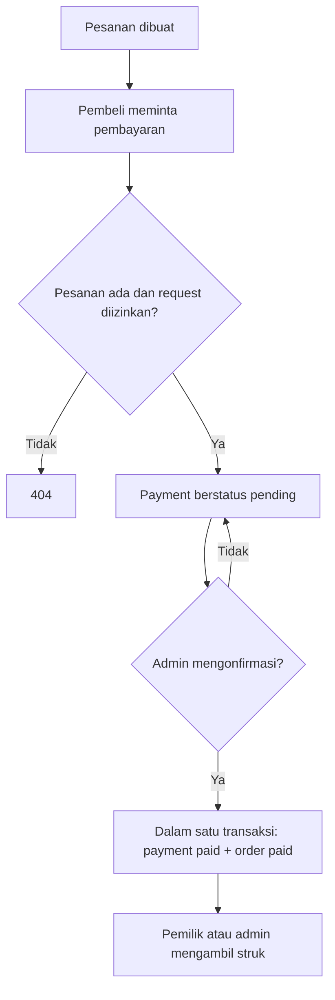

# `src/handlers/payments.rs` — Pembayaran dan Struk

File ini menangani permintaan pembayaran untuk pesanan, daftar pembayaran untuk admin, konfirmasi manual, dan struk setelah pembayaran lunas. Pada proyek ini pembayaran belum dikirim ke bank atau payment gateway; sistem hanya mencatat metode dan status yang dipilih.

Navigasi: [indeks catatan](../README.md) · [routing](../routes.md) · [pesanan](orders.md) · [model/database](../db.md) · [autentikasi](auth.md).

File sumber: [payments.rs](../../src/handlers/payments.rs).

## Alur pembayaran



Satu pesanan hanya dapat memiliki satu baris pembayaran karena `payments.order_id` unik. Permintaan kedua untuk pesanan yang sama mendapatkan `409 Conflict`.

## Endpoint dan akses

| Metode dan path | Fungsi | Siapa | Hasil utama |
|---|---|---|---|
| `GET /api/payments` | `list_payments` | Admin | Daftar pembayaran terbaru lebih dulu. |
| `POST /api/orders/{id}/payment` | `create_payment` | Pembeli pemilik pesanan atau admin | Payment baru berstatus `pending`. `{id}` adalah ID pesanan. |
| `POST /api/payments/{id}/confirm` | `confirm_payment` | Admin | Mengubah payment dan pesanan menjadi `paid`. `{id}` adalah ID payment. |
| `GET /api/orders/{id}/receipt` | `get_receipt` | Pembeli pemilik pesanan atau admin | Struk untuk pesanan yang sudah dibayar. `{id}` adalah ID pesanan. |

Route dan middleware di [routes.rs](../routes.md) memeriksa role sebelum fungsi di file ini dijalankan. Handler tetap memeriksa kepemilikan melalui query untuk operasi pembeli.

## Input pembayaran

Body untuk membuat permintaan pembayaran:

```json
{"method":"bank_transfer"}
```

`CreatePaymentInput` hanya memiliki `method: String`. Handler menghapus spasi tepi dengan `trim()`, lalu hanya menerima `cash` atau `bank_transfer`. Nilai lain mengembalikan `400 Bad Request`.

## Fungsi satu per satu

### `list_payments`

Mengambil semua baris dari `payments`, mengurutkan berdasarkan ID dari terbesar ke terkecil, lalu mengubah setiap hasil menjadi object JSON dengan `id`, `order_id`, `user_id`, `method`, `status`, dan `created_at`. Waktu dibuat diformat sebagai teks UTC, misalnya `2026-11-03T10:20:30Z`. Query gagal menjadi error server `500`.

### `create_payment`

1. Mengambil identitas terverifikasi (`user_id` dan role) dari request yang sudah melewati middleware.
2. Memeriksa metode pembayaran. Hanya `cash` dan `bank_transfer` yang diterima.
3. Menjalankan `INSERT ... SELECT` terhadap pesanan. Untuk admin, syarat pemilik dilewati; untuk pembeli, `orders.user_id` harus sama dengan ID akun aktif.
4. Database membuat payment berstatus awal `pending` dan mengembalikan ID, metode, serta status.
5. Jika tidak ada pesanan yang cocok atau pesanan bukan milik pengguna, hasilnya `404`. Jika payment untuk pesanan itu sudah ada (constraint unik), hasilnya `409`. Keberhasilan menghasilkan `201 Created`.

Contoh response:

```json
{
  "payment_id": 18,
  "order_id": 42,
  "method": "bank_transfer",
  "status": "pending",
  "message": "Pembayaran menunggu verifikasi admin"
}
```

Pembuatan payment hanya mencatat permintaan. Admin perlu memeriksa pembayaran di luar aplikasi sebelum memakai endpoint konfirmasi.

### `confirm_payment`

Admin mengirim ID payment, bukan ID pesanan. Fungsi membuka transaksi database lalu mencoba mengubah payment dari `pending` menjadi `paid` dan mengisi `paid_at`. Kondisi `WHERE id = $1 AND status = 'pending'` membuat payment yang sudah dikonfirmasi tidak diproses ulang.

Jika payment ditemukan, handler juga mengubah status pesanan terkait menjadi `paid`, kemudian melakukan `commit`. Kedua perubahan berada dalam satu transaksi: jika langkah database gagal sebelum commit, perubahan tidak disimpan sebagian. Jika payment tidak ada atau statusnya bukan `pending`, transaksi di-`rollback` dan response-nya `409 Conflict`.

### `get_receipt`

Mencari pesanan yang sudah memiliki payment `paid`. Query mengizinkan admin melihat semua pesanan; pembeli hanya dapat melihat pesanan dengan `user_id` miliknya.

Total dihitung dari `unit_price * quantity`, memakai harga snapshot pada saat order dibuat. Fungsi mengembalikan `409 Conflict` jika data lama tidak memiliki snapshot harga atau waktu `paid_at`. Jika data tidak ditemukan, belum lunas, atau bukan milik pembeli, response `404`. Response sukses berisi nomor `RST-{order_id}`, identitas pesanan, jumlah, total, mata uang `IDR`, dan waktu pembayaran UTC.

## Arti query dan tipe yang mungkin membingungkan

| Kode | Arti sederhana |
|---|---|
| `query_as::<_, (i32, String, ...)>` | Ambil kolom dan cocokkan urutannya dengan tipe tuple yang ditulis. `_` meminta Rust menyimpulkan tipe query. |
| `fetch_all` | Ambil semua row, termasuk hasil kosong. |
| `fetch_optional` | Ambil satu row jika ada; hasil tanpa row menjadi `None`, bukan error database. |
| `Option<Decimal>` | Harga total bisa kosong, misalnya data order lama belum punya snapshot harga. |
| `INSERT ... SELECT` | Membuat payment dari row order yang lolos syarat kepemilikan dalam satu query. |
| `transaction.commit()` | Menyimpan semua perubahan transaksi bersama-sama. |
| `transaction.rollback()` | Membatalkan perubahan transaksi. |
| `map_err(...)` | Mengubah error database menjadi error HTTP dengan pesan yang cocok untuk endpoint. |

## Status dan respons umum

| Status HTTP | Arti di handler ini |
|---|---|
| `201` | Permintaan pembayaran berhasil dibuat. |
| `200` | Daftar, konfirmasi, atau struk berhasil dikirim. |
| `400` | Metode pembayaran tidak dikenal. |
| `404` | Pesanan/payment tidak tersedia untuk akun/request tersebut. |
| `409` | Payment sudah pernah dibuat, payment tidak lagi pending, atau data penting struk tidak tersedia. |
| `500` | Query atau transaksi gagal. |
| `401` / `403` | Token atau role ditolak oleh middleware sebelum handler dipanggil. |

Skema database juga mengenal status `rejected`, tetapi file handler saat ini belum menyediakan endpoint yang mengubah payment menjadi status tersebut.

---

Kembali ke [peta handler](../README.md) atau [peta catatan kode](../../catatan.md).
