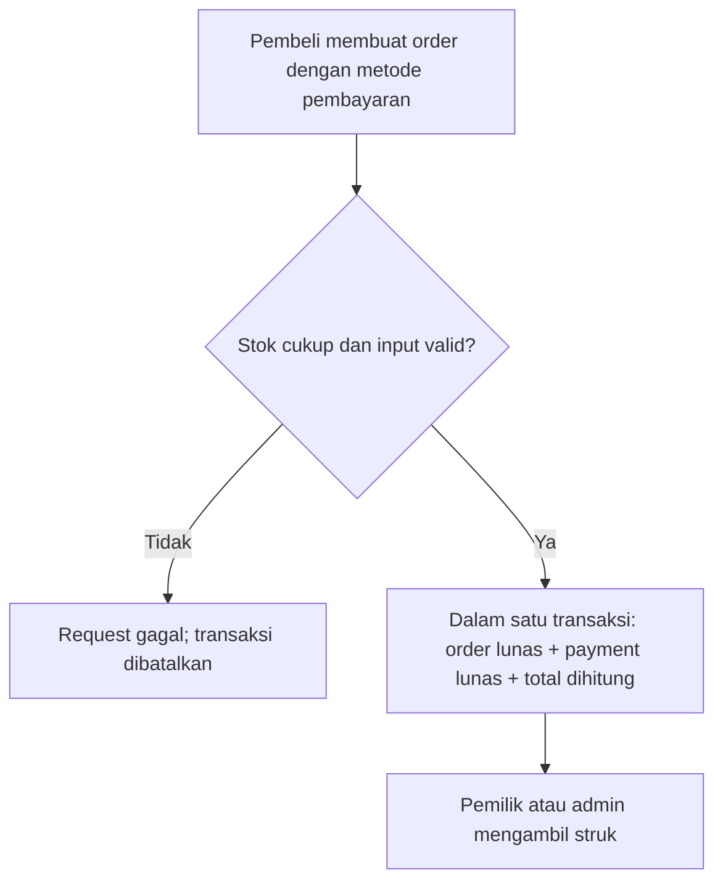

# `src/handlers/payments.rs` — Pembayaran dan Struk

File ini menangani daftar pembayaran untuk admin dan struk. Payment dibuat otomatis saat order dibuat oleh handler orders; pembayaran tidak dikirim ke bank/payment gateway dan status lunas hanya untuk simulasi.

Navigasi: [indeks catatan](../README.md) · [routing](../routes.md) · [pesanan](orders.md) · [model/database](../db.md) · [autentikasi](auth.md).

File sumber: [payments.rs](../../src/handlers/payments.rs).

## Alur pembayaran



  Satu order dan satu payment dibuat bersamaan dalam transaksi database. Total berasal dari snapshot harga menu dikali jumlah, bukan angka yang dikirim klien.

## Endpoint dan akses

| Metode dan path | Fungsi | Siapa | Hasil utama |
|---|---|---|---|
| `GET /api/payments` | `list_payments` | Admin | Daftar pembayaran terbaru lebih dulu. |
| `GET /api/orders/{id}/receipt` | `get_receipt` | Pembeli pemilik pesanan atau admin | Struk untuk pesanan yang sudah dibayar. `{id}` adalah ID pesanan. |

Route dan middleware di [routes.rs](../routes.md) memeriksa role sebelum fungsi di file ini dijalankan. Handler tetap memeriksa kepemilikan melalui query untuk operasi pembeli.

## Input dan response pembayaran

Metode pembayaran dikirim bersama order ke `POST /api/orders`:

```json
{"customer_name":"Budi","menu_id":1,"quantity":2,"payment_method":"bank_transfer"}
```

Server hanya menerima `cash` atau `bank_transfer`, menghitung total berdasarkan data menu, lalu mencatat order dan payment dengan status `lunas`.

## Fungsi satu per satu

### `list_payments`

Mengambil semua baris dari `payments`, mengurutkan berdasarkan ID dari terbesar ke terkecil, lalu mengubah setiap hasil menjadi object JSON dengan `id`, `order_id`, `user_id`, `method`, `status`, dan `created_at`. Waktu dibuat diformat sebagai teks UTC, misalnya `2026-11-03T10:20:30Z`. Query gagal menjadi error server `500`.

### `get_receipt`

Mencari pesanan yang sudah memiliki payment `lunas`. Query mengizinkan admin melihat semua pesanan; pembeli hanya dapat melihat pesanan dengan `user_id` miliknya.

Total dihitung dari `unit_price * quantity`, memakai harga snapshot pada saat order dibuat. Fungsi mengembalikan `409 Conflict` jika data lama tidak memiliki snapshot harga atau waktu `paid_at`. Jika data tidak ditemukan, belum lunas, atau bukan milik pembeli, response `404`. Response sukses berisi nomor `RST-{order_id}`, identitas pesanan, jumlah, total, mata uang `IDR`, dan waktu pembayaran UTC.

## Arti query dan tipe yang mungkin membingungkan

| Kode | Arti sederhana |
|---|---|
| `query_as::<_, (i32, String, ...)>` | Ambil kolom dan cocokkan urutannya dengan tipe tuple yang ditulis. `_` meminta Rust menyimpulkan tipe query. |
| `fetch_all` | Ambil semua row, termasuk hasil kosong. |
| `fetch_optional` | Ambil satu row jika ada; hasil tanpa row menjadi `None`, bukan error database. |
| `Option<Decimal>` | Harga total bisa kosong, misalnya data order lama belum punya snapshot harga. |
| `INSERT ... SELECT` | Membuat payment dari row order yang lolos syarat kepemilikan dalam satu query. |
| `transaction.commit()` | Menyimpan semua perubahan transaksi bersama-sama. |
| `transaction.rollback()` | Membatalkan perubahan transaksi. |
| `map_err(...)` | Mengubah error database menjadi error HTTP dengan pesan yang cocok untuk endpoint. |

## Status dan respons umum

| Status HTTP | Arti di handler ini |
|---|---|
| `201` | Order dan payment simulasi berhasil dibuat. |
| `200` | Daftar payment atau struk berhasil dikirim. |
| `400` | Metode pembayaran tidak dikenal. |
| `404` | Pesanan tidak tersedia untuk akun/request tersebut. |
| `409` | Data penting struk tidak tersedia. |
| `500` | Query atau transaksi gagal. |
| `401` / `403` | Token atau role ditolak oleh middleware sebelum handler dipanggil. |

Status lunas tidak memverifikasi uang tunai secara fisik atau transfer bank. Untuk transaksi nyata diperlukan integrasi provider pembayaran.

---

Kembali ke [peta handler](../README.md) atau [peta catatan kode](../../catatan.md).
