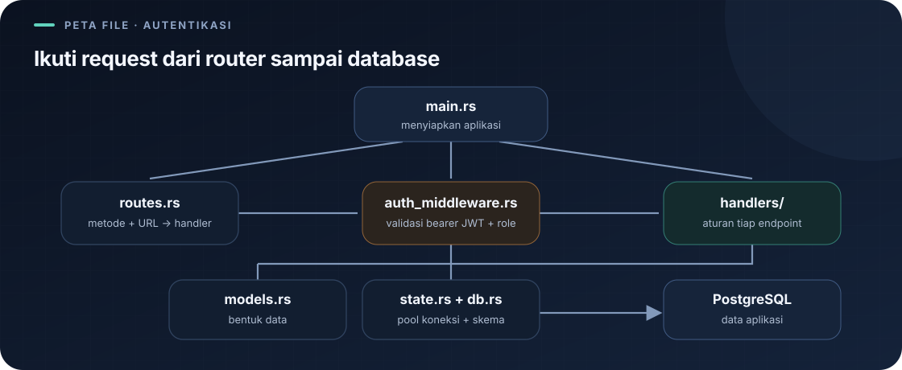

# `src/state.rs`

File ini menyediakan state aplikasi yang diperlukan banyak handler.

Navigasi: [indeks](README.md) · [startup](main.md) · [model data](models.md).

> **Inti bab:** `AppState` membagikan dua kebutuhan bersama: pool database dan layanan JWT untuk memeriksa identitas login.

File sumber: [state.rs](../src/state.rs).

`use sqlx::PgPool;` mengimpor handle pool PostgreSQL.



```rust
use crate::auth::jwt::JwtService;
use sqlx::PgPool;

pub struct AppState {
    pub db: PgPool,
    pub jwt: JwtService,
}
```

`AppState` adalah struct publik agar dapat digunakan modul lain. Field `db` menyimpan pool SQLx; field `jwt` menyimpan layanan untuk membuat dan memeriksa token. `main.rs` membuatnya dengan `AppState { db: pool.clone(), jwt: jwt.clone() }`, lalu membungkusnya dalam `web::Data`. Handler memakai `state.db` untuk query; middleware memakai `state.jwt` untuk memeriksa token.

`web::Data` adalah mekanisme Actix untuk membagikan data aplikasi dan mengekstraknya dalam handler. Pool bukan salinan isi database; clone pool adalah handle tambahan yang tetap mengacu pada pool yang dikelola SQLx.

## JWT Service di `AppState`

`AppState` membagikan pool database dan layanan JWT ke handler serta middleware. Middleware memvalidasi bearer token dan menaruh identitas pengguna pada request extensions; secret penandatangan dikelola oleh layanan JWT.

Alur dependency-nya:

```text
main.rs membuat PgPool
       ├─ membuat JwtService
       ↓ membungkus keduanya
AppState { db, jwt }
       ↓ web::Data<AppState>
handler memakai state.db; middleware memakai state.jwt
```

## Mengurai Sintaks File

- `use sqlx::PgPool;` mengimpor nama `PgPool` agar tipe field dapat ditulis singkat.
- `pub struct AppState { ... }` mendeklarasikan tipe data baru bernama `AppState`. `pub` membuat tipenya dapat digunakan dari modul lain.
- `pub db: PgPool` menyatakan field bernama `db`, bertipe `PgPool`; `pub jwt: JwtService` menyatakan field untuk layanan JWT. `pub` kedua membuat field dapat diakses dari modul handler/middleware.
- `AppState { db: pool.clone(), jwt: jwt.clone() }` adalah struct literal: membuat nilai `AppState` dan mengisi kedua field-nya. Clone membuat handle layanan yang dapat dibagikan, bukan menggandakan isi database atau secret menjadi teks baru.
- `pool.clone()` memanggil method `clone` untuk membuat handle lain. Pool SQLx dirancang untuk dibagikan; clone ini bukan penggandaan semua koneksi atau seluruh data di PostgreSQL.
- `web::Data::new(...)` membuat pembungkus data aplikasi yang cocok dengan mekanisme Actix. Handler meminta nilai itu sebagai parameter `web::Data<AppState>`.
- `state.db` mengakses field publik `db` dari parameter bernama `state`. Deref yang disediakan `web::Data` membuat field state dapat diakses langsung.
- `state.jwt` mengakses layanan JWT yang sama-sama dibagikan oleh state; middleware menggunakannya untuk memeriksa bearer token.

## Mengapa Tidak Menaruh Semua di Handler?

`AppState` memisahkan dependency bersama dari logika endpoint. Saat ini ia menyimpan pool DB dan layanan JWT. Jika field state berubah, pembuatan state di `main.rs` dan kebutuhan handler/middleware yang menggunakannya perlu tetap konsisten.

---

Kembali ke [indeks catatan](README.md) atau lanjut ke [model data](models.md).
